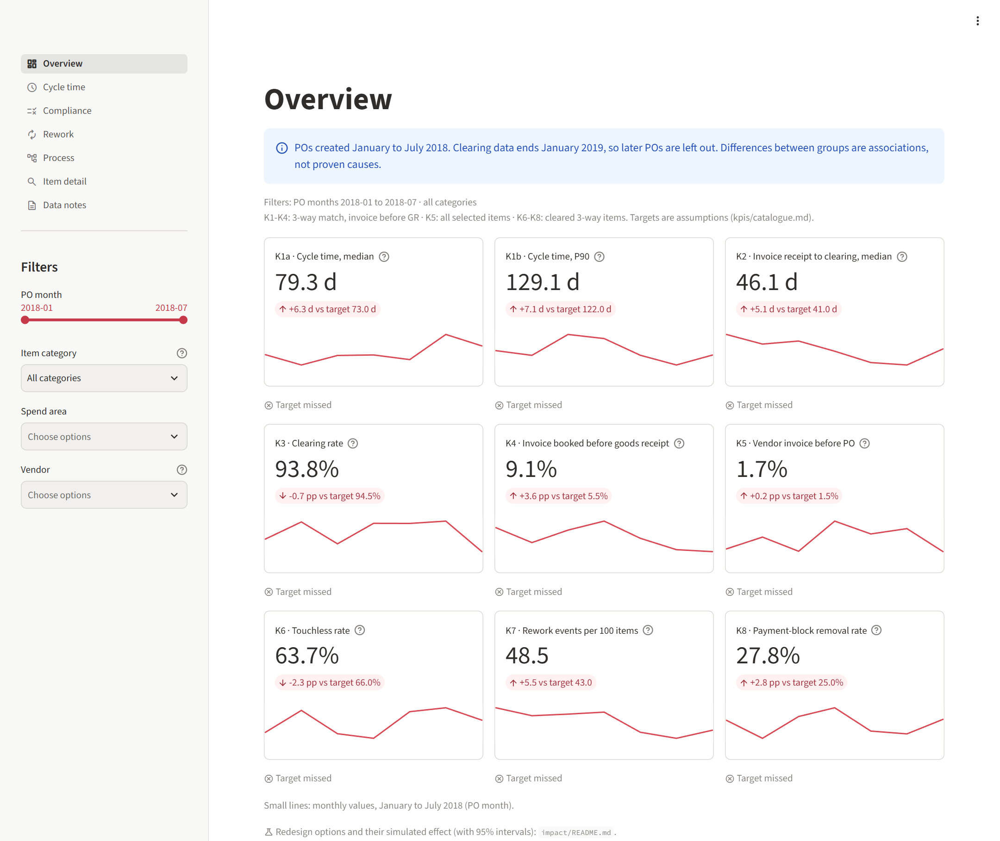
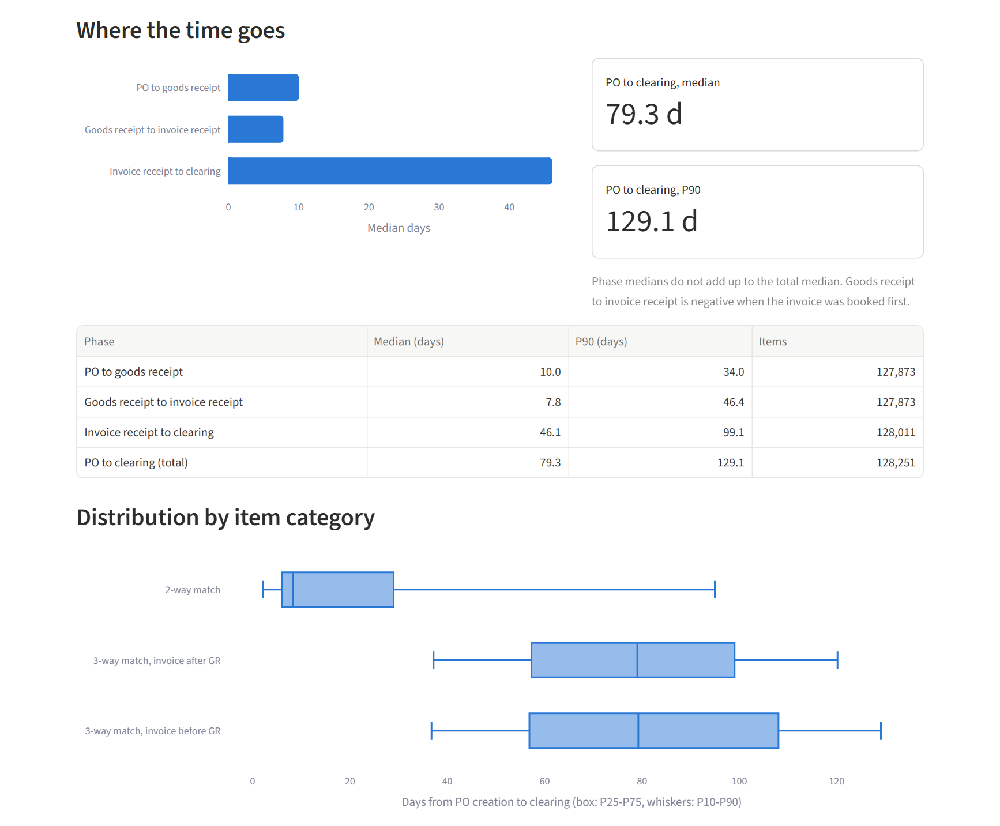
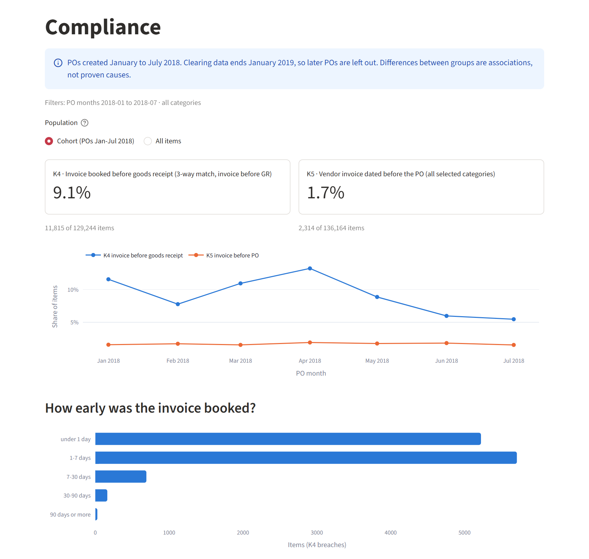
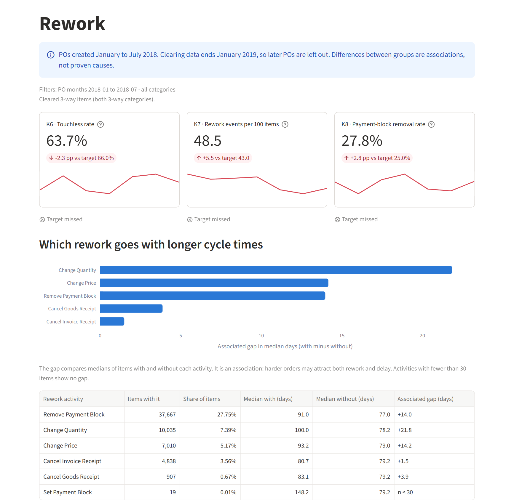
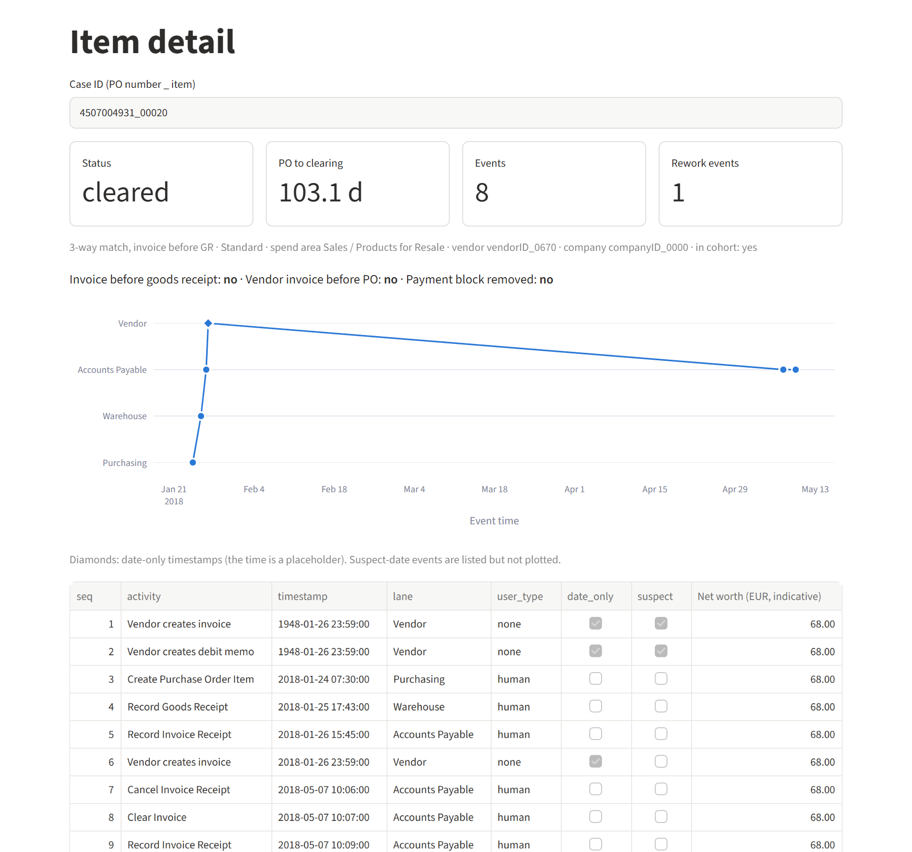
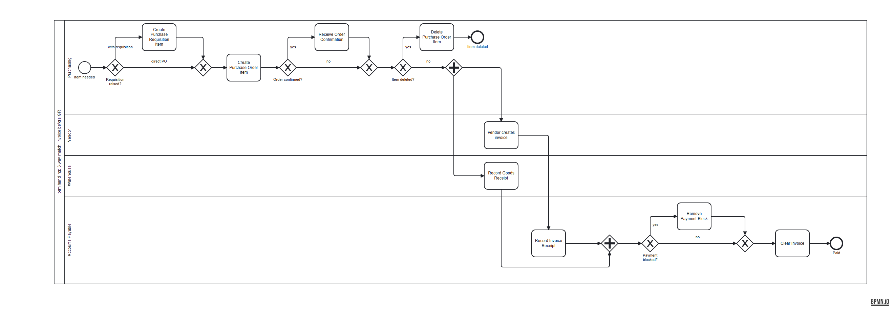
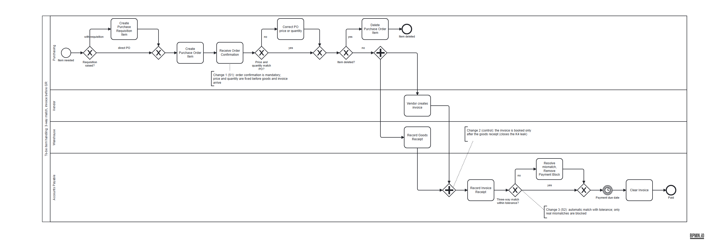
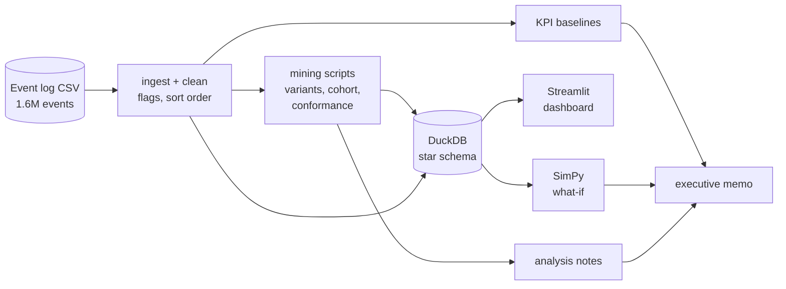

# Purchase-to-Pay Process Intelligence

**Where does a large company's purchase-to-payment process lose time and break its own rules, and which change would fix it, by how much?**
Process mining on 1.6 million real purchase-order events (BPI Challenge 2019), from cleaned data and as-is models to KPIs, a data warehouse, a dashboard and a simulated to-be process.

**Read first:** [two-page executive memo](memo.pdf) · [cohort findings](mining/notes/04-cohort-findings.md) · [simulation](impact/README.md) · [comparison with published reports](mining/notes/06-comparison-with-published-reports.md)



## Key findings

Main flow "3-way match, invoice before goods receipt" (88% of items); POs created January to July 2018 (see [data limits](#data-and-limits)).

| | Finding | Evidence |
| --- | --- | --- |
| 1 | **Paying suppliers takes a median 79.3 days** (one in ten over 129 days). 58% of it (46.1 days) comes after the invoice is booked; 91% of items are paid more than two weeks after both goods and invoice are in. | Payment timing, likely payment terms, sets the cycle time (a hypothesis: the log has no terms field). |
| 2 | **The three-way-match control leaks:** 9.1% of items (11,815 of 129,244) had the invoice booked before the goods receipt. | One supplier accounts for 18% of these, ten suppliers for 46%. |
| 3 | **Rework is common and goes with about 18 extra days:** 91.0 against 73.4 days median; 36% of paid items have a price or quantity change, cancellation or payment block. | Association, not proven cause. Quantity changes go with +21.8 days; payment-block removals, on 28% of items, with +14.0 days. |
| 4 | **But removing rework buys little time.** In a validated simulation, preventing half the payment blocks saves 1.3 days at the median (95% interval 1.0 to 1.9) and lifts untouched items from 64% to 75%; with half the order rework also prevented, 2.4 days (2.0 to 3.0). | The payment due date absorbs most order-side delay. The value of fixing rework is effort and control, not speed. |

## What's in the repository

| Deliverable | Where | Highlights |
| --- | --- | --- |
| Problem brief | [`brief/brief.md`](brief/brief.md) | Process owner, five questions, scope, known limits |
| Process mining | [`mining/`](mining/), notes [01](mining/notes/01-exploration.md) to [06](mining/notes/06-comparison-with-published-reports.md) | Variants, right-censoring check, cohort metrics, token-replay conformance (91.6% of finished cases fit) |
| BPMN models | [`bpmn/`](bpmn/) | As-is and to-be models (Camunda Modeler / bpmn-js), with PNG previews |
| KPI catalogue | [`kpis/catalogue.md`](kpis/catalogue.md) | 8 KPIs with formula, owner, baseline, monthly range and target |
| Data warehouse | [`model/`](model/README.md) | DuckDB star schema: 2 fact tables, 6 dimensions, KPI views in SQL; ER diagram |
| Requirements | [`requirements/`](requirements/dashboard_requirements.md) | Users, data rules, 24 functional and 7 non-functional requirements, [14 user stories](requirements/user_stories.md) |
| Dashboard | [`app/app.py`](app/app.py) | Streamlit, 7 pages, filters, drill-down to single items, CSV export |
| What-if simulation | [`impact/README.md`](impact/README.md) | SimPy model built from observed items, validated against reality, paired 95% intervals |
| Executive memo | [`memo.pdf`](memo.pdf) | Two pages for the process owner, with four decisions requested |
| Tests | [`tests/`](tests/) | 54 tests: data, KPIs, warehouse, dashboard queries and pages, simulation |

## Dashboard

Built on the warehouse; every number matches the SQL KPI view (checked by tests). Each page states the cohort and that group differences are associations.

| | |
| --- | --- |
|  |  |
| **Cycle time.** Where the time goes: 10 days to goods receipt, 46 days from invoice booking to payment. | **Compliance.** Early invoice bookings and invoices dated before the PO, by month, supplier and spend area, with the item list behind each figure. |
|  |  |
| **Rework.** Touchless share, rework per 100 items, and the associated gap per rework type. | **Item detail.** Any item's events in order, with date-only and suspect timestamps marked. |

Also included: a **Process** page (top variants, conformance results and the BPMN model) and a **Data notes** page (limits, citation, warehouse build info).

## Process models

**As-is** (main flow, lanes Purchasing, Vendor, Warehouse, Accounts Payable):



**To-be**, with three changes: a mandatory order confirmation with price and quantity check; invoice booking only after goods receipt; automatic matching with tolerance and payment on the due date:



## How it works



Method choices that matter:

- **Censoring-aware cohort.** Clearing events stop in January 2019, so items ordered late in 2018 look faster than they are. Time and rework measures use POs created January to July 2018 rather than dropping open cases ([note 03](mining/notes/03-censoring.md)).
- **Conformance on a variant-level log** with token-based replay, after fixing a same-day ordering artefact of date-only timestamps ([note 05](mining/notes/05-conformance.md)).
- **Simulation that reproduces reality first.** Two simpler model structures were rejected because they overstated the 90th percentile by 12 days; the final one matches it within 0.1 day ([impact](impact/README.md)).
- **Checked against the field.** Headline numbers agree with five published challenge reports, including both winners, within a few days or points ([note 06](mining/notes/06-comparison-with-published-reports.md)).

## Questions answered

| Question (from the [brief](brief/brief.md)) | Answer |
| --- | --- |
| 1. How long from PO to cleared invoice, and where is the wait? | Median 79.3 days, P90 129.1 (main flow); 58% after the invoice is booked |
| 2. How often is the invoice early, or before the PO? | 9.1% booked before the goods receipt; 1.7% of vendor invoices dated before the PO |
| 3. How much rework, and what does it add? | 36% of paid items; associated with +17.6 days at the median |
| 4. What share runs untouched? | 63.7% of paid three-way-match items |
| 5. Which change helps most, by how much? | Preventing payment blocks: 1.3 days (1.0 to 1.9) for half the blocks, +11 points untouched |

## Data and limits

[BPI Challenge 2019](https://icpmconference.org/2019/?p=302): purchase-order handling at a Dutch multinational in coatings and paints. 1,595,923 events, 251,734 PO line items (cases), 42 activities, four item flows.

- **Source:** van Dongen, B.F. (2019). BPI Challenge 2019. 4TU.ResearchData. [doi:10.4121/uuid:d06aff4b-79f0-45e6-8ec8-e19730c248f1](https://doi.org/10.4121/uuid:d06aff4b-79f0-45e6-8ec8-e19730c248f1). This project used a third-party CSV conversion because data.4tu.nl timed out; checksum and details in [`data/SOURCE.md`](data/SOURCE.md). The data is not in this repository.
- **Clearing is cut off** in January 2019 while other events run to April 2020; hence the January to July 2018 cohort (155,761 items) for time, clearing and rework measures.
- **Date-only timestamps** for vendor invoice, debit memo and requisition (durations in days; same-day ordering needs a tie-break).
- **100 events with impossible dates** (e.g. 1948) are flagged and excluded from durations.
- **Payment blocks:** setting a block is rarely logged (124 events against 57,136 removals), so removals stand in.
- **"Received, never invoiced"** in the invoice-after-goods-receipt flow (14.1%) rises for later months, so it is partly truncation and not reported as a finding.
- **Anonymised:** suppliers, users and companies are IDs; KPI targets are proposals, not company policy.

## Reproduce

Requires Python 3.12 and [uv](https://docs.astral.sh/uv/).

```bash
uv sync
# download BPI_Challenge_2019.csv.gz from the release named in data/SOURCE.md
# and place it in data/raw/ (check its SHA-256 against data/SOURCE.md)
make all        # the whole pipeline below, in order (about 6 minutes)
make app        # dashboard at http://localhost:8501
make test lint  # 54 tests (data tests skip without the data) and ruff
```

| Target | Does | Output (git-ignored) |
| --- | --- | --- |
| `make ingest` | CSV to parquet, cleaning and flags | `data/interim/` |
| `make mining` | Analysis scripts, including conformance | `mining/outputs/` |
| `make kpis` | KPI baselines | `kpis/outputs/` |
| `make warehouse` | DuckDB star schema (needs `make mining` for conformance results) | `data/warehouse/p2p.duckdb` |
| `make simulate` | To-be what-if simulation (about 3 minutes) | `impact/outputs/` |

The memo PDF is printed from `memo/memo.html` with headless Chrome (A4, no header or footer); in Git Bash on Windows:

```bash
"/c/Program Files/Google/Chrome/Application/chrome.exe" --headless=new --disable-gpu --no-pdf-header-footer --print-to-pdf="$(pwd -W)/memo.pdf" "file:///$(pwd -W)/memo/memo.html"
```

## Stack

Python 3.12 · uv · pm4py · polars · DuckDB · SimPy · Streamlit · Plotly · Camunda Modeler / bpmn-js · pytest · ruff

## References

- van Dongen, B.F. (2019). BPI Challenge 2019. 4TU.ResearchData. doi:10.4121/uuid:d06aff4b-79f0-45e6-8ec8-e19730c248f1
- BPI Challenge 2019 page, with all submitted reports: https://icpmconference.org/2019/?p=302
- Diba, Remy, Pufahl. *Compliance and Performance Analysis of Procurement Processes Using Process Mining.* BPI Challenge 2019 (overall winner).
- Meyer zu Wickern, Juluru, Roy, Nguyen, Vu. *Analysis and prediction of purchasing compliance using process mining.* BPI Challenge 2019 (student winner).
- Gutermuth, Lahann, Rehse, Scheid, Schuhmann, Stephan, Fettke. *Efficient and Compliant Purchase Order Handling: A Contribution to BPI Challenge 2019.* doi:10.22028/D291-34142
- van Dyk, Aklecha, Kennes, Ramezani. *Dissecting the Purchase-to-Pay Process: An exercise in Process Mining.* BPI Challenge 2019.
- Porter, Masse, Visatemongkolchai, Seneviratne, Deokule, Hartman. *Balancing Efficiency and Risk in Procure to Pay.* BPI Challenge 2019.

## Author and licence

Khandaker Abrar Yasir, November 2026. Code licensed as in [`LICENSE`](LICENSE). This project depends on [pm4py](https://pm4py.fit.fraunhofer.de/), licensed under the GNU AGPL v3; pm4py is not included here but installed by `uv sync`. Anyone redistributing or offering this project as a network service together with pm4py should check the AGPL v3 terms.
