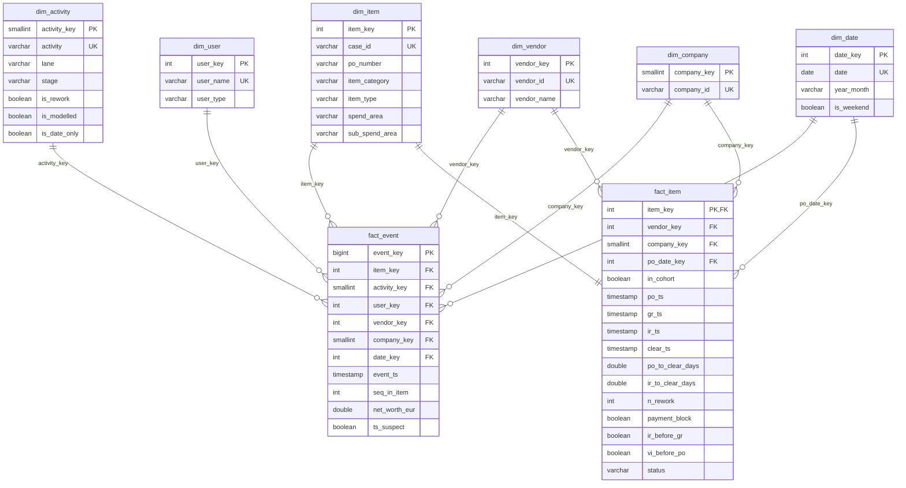

# Data model: DuckDB star schema

A star schema over the cleaned BPI Challenge 2019 log, used by the dashboard and the KPI views. Built from `data/interim/events_clean.parquet` by `src/p2p/warehouse.py` (`make warehouse`, about 15 seconds) into `data/warehouse/p2p.duckdb`. The database is git-ignored and rebuilt from scratch on every run.

| File | Content |
| --- | --- |
| [`schema.sql`](schema.sql) | Tables with primary and foreign keys, plus the views `v_item` and `v_kpi` |
| [`load.sql`](load.sql) | Populates the tables from the cleaned events |
| [`activity_map.csv`](activity_map.csv) | Hand-made mapping of the 42 activities to lane, stage, rework flag and BPMN membership |
| `../tests/test_warehouse.py` | Row counts, key integrity, and KPI view against `src/p2p/kpis.py` |

## ER diagram



The diagram shows the main columns only; `schema.sql` has all of them.

## Tables

| Table | Grain | Rows |
| --- | --- | --- |
| `fact_event` | One logged event | 1,595,923 |
| `fact_item` | One PO line item (accumulating snapshot: milestone timestamps, durations, counts, flags) | 251,734 |
| `dim_item` | One PO line item: category, type, spend area, flags | 251,734 |
| `dim_activity` | One activity | 42 |
| `dim_vendor` | One vendor (anonymised) | 1,975 |
| `dim_company` | One company code | 4 |
| `dim_user` | One user (human, batch or `NONE`) | 628 |
| `dim_date` | One calendar day, 1948-01-26 to 2020-04-09 | 26,373 |

## Views

- `v_item`: `fact_item` joined to its item, vendor and company attributes. The usual starting point for item-level questions.
- `v_kpi`: the 8 KPIs of [`kpis/catalogue.md`](../kpis/catalogue.md) on the January to July 2018 cohort, one row per PO month plus a `po_month = 'all'` row. It reproduces the Python baselines in `src/p2p/kpis.py` (checked by tests).

## Design decisions

- **Two fact tables.** `fact_event` keeps the full log for process views (variants, directly-follows, resource load). `fact_item` gives one row per item so KPI and dashboard queries do not have to re-aggregate 1.6 million events.
- **The item is both a dimension and a fact grain.** Descriptive attributes (category, spend area) sit in `dim_item`; measured milestones and counts sit in `fact_item`, one to one.
- **Vendor and company keys on both facts.** They are constant per item, but carrying them on the facts keeps it a star rather than a snowflake and makes vendor filters a single join.
- **Same rules as the analysis.** `fact_item` milestones are the first occurrence of each activity among events with `ts_suspect = false`, as in `mining/cohort_metrics.py`. `in_cohort` marks POs created January to July 2018 (see [`mining/notes/03-censoring.md`](../mining/notes/03-censoring.md)).
- **Suspect events are kept.** `fact_event` holds all 1,595,923 events with the `ts_suspect` flag, so `dim_date` reaches back to 1948.
- **`status`** sorts each item into exactly one of: cleared, deleted, invoice not cleared, received not invoiced, ordered only (the breakdown in [`mining/notes/04-cohort-findings.md`](../mining/notes/04-cohort-findings.md)).
- **Surrogate keys** are integers assigned in natural-key order. They are stable as long as the source data does not change.
- **`net_worth_eur`** is the log's cumulative net worth at each event. It is indicative, not an invoice or payment amount.
- **`user`** only: the log's `resource` column is identical to `user` on every event.

## Example queries

```sql
-- Cycle time and touchless share by spend area (cohort, main category, cleared)
SELECT spend_area, count(*) AS items,
       median(po_to_clear_days) AS median_days,
       avg((n_rework = 0)::INT) AS touchless
FROM v_item
WHERE in_cohort AND cleared AND item_category = '3-way match, invoice before GR'
GROUP BY 1 ORDER BY items DESC;

-- Events per lane and month
SELECT d.year_month, a.lane, count(*) AS events
FROM fact_event e
JOIN dim_activity a USING (activity_key)
JOIN dim_date d USING (date_key)
WHERE NOT e.ts_suspect
GROUP BY ALL ORDER BY ALL;
```
